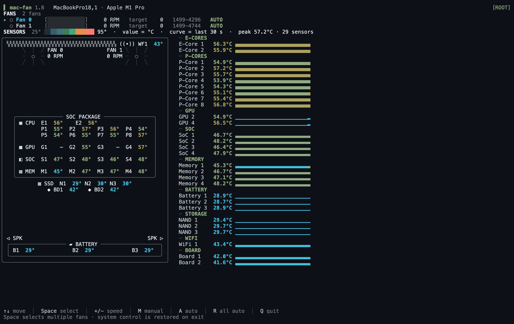

# mac-fan

[English](README.md) | [简体中文](README.zh-CN.md)

A terminal UI for Apple Silicon Macs that reads the thermal sensors and drives the
fans directly through AppleSMC — no daemon, no kernel extension, no third-party
dependencies. Written in Go with cgo bindings to IOKit.



## Features

- **Live thermal map** — 31 SMC sensors (E-cores, P-cores, GPU, SoC, unified
  memory, battery, NAND, Wi-Fi, board), sampled once per second.
- **Top-down hardware schematic** — the left panel follows the real internals of
  the detected series: rear vent/antenna strip, blower positions, SoC package,
  NAND and board sensors, battery across the front.
- **Fan control** — manual RPM targets with cursor + multi-select, plus restore
  to automatic control on quit.
- **30-second curves** — sparkline per sensor, colour-coded from cool to hot.
- **Read-only mode** — run without root to inspect only.
- Adapts to the terminal: two panels when wide, compact schematic when short,
  single sensor column when narrow.

## Requirements

- An Apple Silicon Mac (M1/M2/M3 family) running macOS.
- Go 1.21+ with cgo, and the Xcode Command Line Tools (`xcode-select --install`).

Intel Macs do not expose the same sensor keys; sensor discovery is best-effort.

macOS only: fan control uses Apple's SMC through IOKit, which does not exist on
Windows or Linux. The code builds on those platforms but exits immediately with
an "only supports Apple Silicon Macs" message, so it can be packaged or
cross-compiled without link errors.

## Install

Homebrew (recommended):

```sh
brew install helios916/mac-fan/mac-fan
```

The formula compiles on your machine (cgo + IOKit) rather than shipping a
prebuilt bottle, so the first install spends a minute or two building. Use
`brew install --HEAD helios916/mac-fan/mac-fan` to follow `main`, `brew upgrade
mac-fan` to update, `brew uninstall mac-fan` to remove. With Homebrew you do
not need to provide Go yourself — Brew pulls the `go` formula — and the Xcode
Command Line Tools are already there.

## Build from source

From a checkout:

```sh
./build.sh                  # builds ./mac-fan and ad-hoc signs it
./build.sh --install        # builds and copies to ~/.local/bin
./build.sh --install DIR    # builds and copies to DIR
```

Or install straight from GitHub — the script downloads the source, sorts out
build dependencies, compiles locally, then copies the binary to `~/.local/bin`:

```sh
curl -fsSL https://raw.githubusercontent.com/helios916/mac-fan/main/install.sh | bash
```

If Go is missing it downloads a portable toolchain into
`~/.local/share/mac-fan/toolchain`; if Xcode Command Line Tools are missing it
opens the system installer and waits for you to click 「Install」 once.
The toolchain download falls back to `golang.google.cn` when `go.dev` is
unreachable; override with `MAC_FAN_GO_BASE`.

Pass a different target with `| bash -s -- /usr/local/bin`.

Make targets remain available: `make` (build + sign), `make install-user`,
`make build` (no signing), `make sign`, `make clean`.

## Usage

Actions are subcommands; options are flags. Fans are addressed by the index
reported by `mac-fan list`.

```sh
sudo mac-fan                 # TUI with fan control
mac-fan --read-only          # TUI, everything visible, nothing writable
mac-fan tui --read-only      # same TUI via its explicit subcommand
mac-fan list                 # fans: index, RPM, target, range, mode
mac-fan list --json
mac-fan status               # fans + all sensors in one snapshot
mac-fan status --json
mac-fan help                 # global help
mac-fan help set             # per-command help with examples
mac-fan version
```

Writing fan speeds requires root. Without it the TUI still starts, shows a
`[READ-ONLY]` badge, and explains what a write action would need.

## Command-line mode

```sh
mac-fan list                                # what indices exist, their min/max
mac-fan set 0 3000 --dry-run                # resolve + clamp, no writes, no sudo
mac-fan set 0 40% --dry-run                 # 40% of fan 0's max RPM

sudo mac-fan set 0 3000 --hold 60           # pin fan 0, then auto-restore
sudo mac-fan set 1 40% --hold 60
sudo mac-fan set all 80% --hold 60

sudo mac-fan auto all                       # restore system control now
sudo mac-fan auto 0
```

`<fan>` is a fan index from `mac-fan list` (`0`, `1`, …) or `all`. The target is
either an absolute RPM (`3000`) or a share of that fan's maximum (`40%`).
Percentages are clamped to the min/max printed by `list`; an absolute RPM below
the minimum is rejected with a hint (`80` means 80 RPM, not 80 percent). `--dry-run` shows the
resolved RPM per fan without touching SMC, so it works without root.

Manual commands stay in the foreground and re-assert the target every second,
because `thermalmonitord` reverts manual mode within about a second. Stop with
`Ctrl-C`, or bound the hold with `--hold 60`. Either way, the fans that were
changed are returned to automatic control on exit.

| Flag | Meaning |
| --- | --- |
| `--dry-run`, `-n` | resolve and print the target, never write |
| `--hold N` | for `set`: stop holding after N seconds (0 = until interrupted) |
| `--json` | JSON output for `list`, `status`, `set`, and `auto` |

Exit codes: `0` success, `1` SMC/permission failure, `2` invalid usage.

Interactive mode uses the alternate screen and raw keyboard input; the terminal
is restored on exit, on `Ctrl-C`, and on `SIGTERM`.

## Keys

| Key | Action |
| --- | --- |
| `↑` `↓` / `j` `k` | move the cursor |
| `Space` | toggle selection and move to the next fan |
| `+` / `-` | raise/lower the selected (or cursor) fans, in manual mode |
| `PgUp` / `PgDn` | raise/lower by 25% of the fan's range |
| `0`–`9` | type an exact target RPM in the always-visible `RPM` field: `Enter` applies, `Backspace` edits, `Q` cancels (clicking the field focuses it too) |
| `M` | switch selected fans to manual control |
| `A` | restore selected fans to automatic control |
| `R` | restore **all** fans to automatic control |
| `Q` / `Ctrl-C` | quit and restore automatic control |
| Mouse | click a fan row to select it, click a control button, wheel over the sensors to scroll |

The status line shows the result of the last action for a few seconds.

## Layouts by series

| Series | Fan arrangement |
| --- | --- |
| MacBook Pro 14″ / 16″ (2021+) | two blowers, one at each rear corner, SoC package between them |
| MacBook Pro 13″ (M1/M2) | single blower at the rear-left, board at the rear-right |
| MacBook Air (M1/M2/M3) | fanless, board at the rear-right, vents along the rear |

Panels split when the terminal is at least 96 columns and 17 rows. The
schematic keeps its three-line rotors and a roomy SoC block while there is
height; as space shrinks it first tightens the SoC block, then collapses the
rotors to a one-line fan row. Below 96 columns the sensor list uses the full
width. The left frame grows at its internal stretch points so both panels end
on the same row.

## How it works

- `smc.go` — AppleSMC IOKit connection, the 80-byte wire struct, four-character
  keys, `flt ` / `ui8 ` decoding and writing.
- `fan.go` — `F0Ac`/`F0Tg`/`F0Mn`/`F0Mx` and mode key `F0Md`; manual targets are
  clamped to the reported minimum and maximum. macOS `thermalmonitord` resets
  the mode every second, so manual mode is re-asserted while it is active.
- `sensors.go` — sensor table, sampling ring buffer, heat colours and sparklines.
- `chassis.go` — per-series top-down schematic, fan rotor animation.
- `ui.go` — rendering, two-panel merge, selection and actions, status messages.
- `term.go` — raw mode, alternate screen metrics, key decoding.
- `cli.go` — subcommands, option parsing, dry-run, hold loop and JSON output.
- `main.go` — TUI loop, terminal detection, elevation prompt, snapshot output.

Sensor keys are model-specific; models that expose a subset simply show fewer
rows, and the list reports `N of 31`.

## Safety

- Fan writes are clamped to the SMC-reported min/max.
- Quitting (or `R`) writes the original automatic mode back to every fan that
  was touched; `mac-fan` never leaves a fan pinned at a manual value on exit.
- Prefer `--read-only` when you only want to watch temperatures.

## Donate

If mac-fan keeps your Mac cool, you can support development through one of
these options:

<table>
<tr>
<td align="center"></td>
<td align="center"></td>
<td align="center"><a href="https://github.com/sponsors/helios916"></a></td>
</tr>
</table>

## License

MIT — see [LICENSE](LICENSE).
