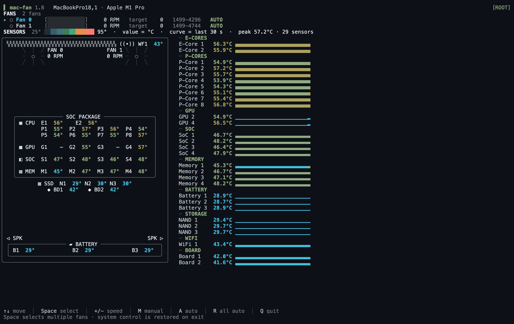

# mac-fan

[English](README.md) | [简体中文](README.zh-CN.md)

面向 Apple Silicon Mac 的终端 UI：直接通过 AppleSMC 读取温度传感器并控制风扇——无守护进程、无内核扩展、无第三方依赖。使用 Go 编写，通过 cgo 调用 IOKit。



## 功能

- **实时热力图**——31 个 SMC 传感器（E 核、P 核、GPU、SoC、统一内存、电池、NAND、Wi-Fi、主板），每秒采样一次。
- **俯视硬件示意图**——左栏按识别到的系列展示真实内部布局：后缘通风/天线条、离心风扇位置、SoC 封装、NAND 与主板传感器、横贯前部的电池。
- **风扇控制**——光标 + 多选设置手动 RPM，退出时恢复自动控制。
- **30 秒曲线**——每个传感器一条 sparkline，按温度从冷到热着色。
- **只读模式**——无需 root 即可查看。
- **自适应终端**——宽屏双栏，高度不足时压缩示意图，窄屏退回单列传感器列表。

## 环境要求

- Apple Silicon Mac（M1/M2/M3 系列），运行 macOS。
- Go 1.21+（启用 cgo），以及 Xcode Command Line Tools（`xcode-select --install`）。

Intel Mac 不暴露相同的传感器键，传感器发现为尽力而为。

## 安装

Homebrew（推荐）：

```sh
brew install helios916/mac-fan/mac-fan
```

公式会在本机编译（cgo + IOKit），不下载预编译包，所以首次安装需要一两分钟编译。跟随 `main` 分支用 `brew install --HEAD helios916/mac-fan/mac-fan`，升级用 `brew upgrade mac-fan`，卸载用 `brew uninstall mac-fan`。装了 Homebrew 就不必单独准备 Go，Brew 会自动装 `go` 公式，并自带 Xcode Command Line Tools。

## 从源码构建

在仓库目录内：

```sh
./build.sh                  # 构建 ./mac-fan 并做 ad-hoc 签名
./build.sh --install        # 构建并复制到 ~/.local/bin
./build.sh --install DIR    # 构建并复制到 DIR
```

或者直接从 GitHub 安装——脚本会下载源码、自动处理构建依赖、在本机编译，再把二进制复制到 `~/.local/bin`：

```sh
curl -fsSL https://raw.githubusercontent.com/helios916/mac-fan/main/install.sh | bash
```

缺 Go 时脚本会自动下载便携工具链到 `~/.local/share/mac-fan/toolchain`；缺 Xcode Command Line Tools 时会唤起系统安装器，点一次「安装」并等待完成即可（Apple 不提供无交互安装接口，这一步无法完全后台完成）。Go 工具链下载失败时会自动回退到 `golang.google.cn` 镜像，也可以设置 `MAC_FAN_GO_BASE` 指定其他镜像。

指定其他安装目录：`| bash -s -- /usr/local/bin`。

Make 目标仍然可用：`make`（构建 + 签名）、`make install-user`、`make build`（不签名）、`make sign`、`make clean`。

## 使用

动作是子命令，选项是 flag；风扇用 `mac-fan list` 报告的索引指定。

```sh
sudo mac-fan                 # 带风扇控制的 TUI
mac-fan --read-only          # 只读 TUI，全部可见，不可写
mac-fan tui --read-only      # 通过显式子命令启动同一个 TUI
mac-fan list                 # 风扇：索引、RPM、目标、范围、模式
mac-fan list --json
mac-fan status               # 风扇 + 全部传感器的一次快照
mac-fan status --json
mac-fan help                 # 全局帮助
mac-fan help set             # 单个命令的帮助与示例
mac-fan version
```

写入转速需要 root。没有 root 时 TUI 仍会启动，显示 `[READ-ONLY]` 徽标，并说明写操作需要什么。

## 命令行模式

```sh
mac-fan list                                # 有哪些索引，各自的 min/max
mac-fan set 0 3000 --dry-run                # 解析 + 夹取，不写 SMC、不需要 sudo
mac-fan set 0 40% --dry-run                 # 风扇 0 最大转速的 40%

sudo mac-fan set 0 3000 --hold 60           # 固定风扇 0，到期自动恢复
sudo mac-fan set 1 40% --hold 60
sudo mac-fan set all 80% --hold 60

sudo mac-fan auto all                       # 立即恢复系统控制
sudo mac-fan auto 0
```

`<fan>` 是 `mac-fan list` 给出的风扇索引（`0`、`1`、…）或 `all`。目标值可以是绝对 RPM（`3000`），也可以是该风扇最大转速的百分比（`40%`）。百分比会夹到 `list` 显示的 min/max；低于最小值的绝对 RPM 会被拒绝并给出提示（`80` 表示 80 RPM，不是 80%）。`--dry-run` 只解析并打印每台风扇的结果，不写 SMC，因此无需 root。

手动命令会留在前台并每秒重申目标值，因为 `thermalmonitord` 约一秒内就会把模式改回自动。用 `Ctrl-C` 结束，或用 `--hold 60` 限定持续时间。无论哪种方式，退出时都会把改动过的风扇恢复为自动控制。

| Flag | 含义 |
| --- | --- |
| `--dry-run`、`-n` | 解析并打印目标值，绝不写入 |
| `--hold N` | 用于 `set`：N 秒后停止保持（0 = 直到被中断） |
| `--json` | `list`、`status`、`set`、`auto` 的 JSON 输出 |

退出码：`0` 成功，`1` SMC/权限失败，`2` 用法错误。

交互模式使用备用屏幕和原始键盘输入；退出、`Ctrl-C` 和 `SIGTERM` 时都会恢复终端。

## 按键

| 按键 | 动作 |
| --- | --- |
| `↑` `↓` / `j` `k` | 移动光标 |
| `Space` | 切换选中并把光标移到下一台风扇 |
| `+` / `-` | 在手动模式下提高/降低选中（或光标所在）风扇的转速 |
| `PgUp` / `PgDn` | 按风扇量程的 25% 提高/降低转速 |
| `M` | 把选中的风扇切换到手动控制 |
| `A` | 把选中的风扇恢复为自动控制 |
| `R` | 把**全部**风扇恢复为自动控制 |
| `Q` / `Ctrl-C` | 退出并恢复自动控制 |
| 鼠标 | 点击风扇行可选中，点击控制按钮可执行，在传感器区域滚动滚轮可翻页 |

状态行会显示最近一次操作的结果，持续几秒。

## 各系列布局

| 系列 | 风扇布局 |
| --- | --- |
| MacBook Pro 14″ / 16″（2021+） | 两台离心风扇，分居后部左右两角，SoC 封装在中间 |
| MacBook Pro 13″（M1/M2） | 单风扇位于左后侧，主板位于右后侧 |
| MacBook Air（M1/M2/M3） | 无风扇，主板位于右后侧，通风口沿后缘分布 |

终端至少 96 列且 17 行时拆分为双栏。高度充足时示意图保留三行转子与宽松的 SoC 区块；空间变小时先收紧 SoC 区块，再把转子压缩成单行风扇行。低于 96 列时传感器列表占满整行。左框会在内部伸缩点增长，使两栏底边落在同一行。

## 实现说明

- `smc.go`——AppleSMC 的 IOKit 连接、80 字节通信结构、四字符键、`flt ` / `ui8 ` 的读写。
- `fan.go`——`F0Ac`/`F0Tg`/`F0Mn`/`F0Mx` 与模式键 `F0Md`；手动目标会夹到上报的 min/max。macOS 的 `thermalmonitord` 每秒重置模式，因此手动模式期间会持续重申。
- `sensors.go`——传感器表、采样环形缓冲、热力色与 sparkline。
- `chassis.go`——按系列绘制的俯视示意图、风扇转子动画。
- `ui.go`——渲染、双栏合并、选中与操作、状态消息。
- `term.go`——原始模式、备用屏幕尺寸、按键解码。
- `cli.go`——子命令、选项解析、dry-run、保持循环与 JSON 输出。
- `main.go`——TUI 循环、终端检测、提权提示、快照输出。

传感器键因机型而异；只暴露部分键的机型会显示更少的行，列表会标注 `N of 31`。

## 安全

- 风扇写入会夹到 SMC 上报的 min/max。
- 退出（或按 `R`）会把所有被改动过的风扇恢复为自动模式；`mac-fan` 不会在退出时把风扇留在手动值。
- 只想观察温度时优先使用 `--read-only`。

## 赞助

如果 mac-fan 对你有帮助，欢迎通过下面任一方式支持这个项目：

<table>
<tr>
<td align="center"></td>
<td align="center"></td>
<td align="center"><a href="https://github.com/sponsors/helios916"></a></td>
</tr>
</table>

## 许可证

MIT——见 [LICENSE](LICENSE)。
